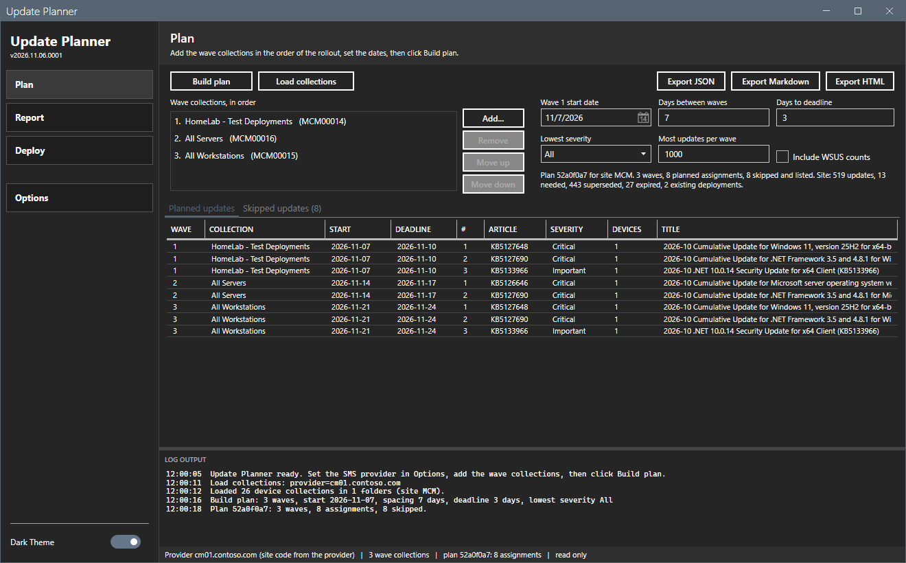
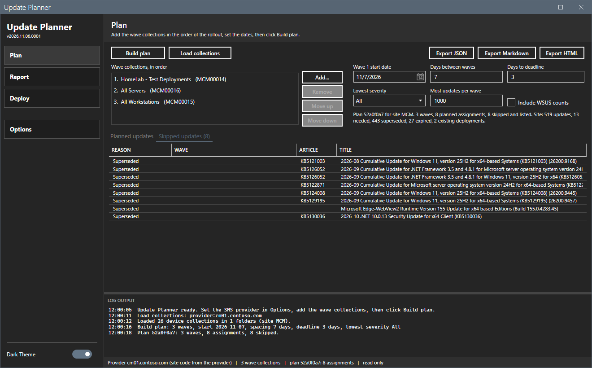
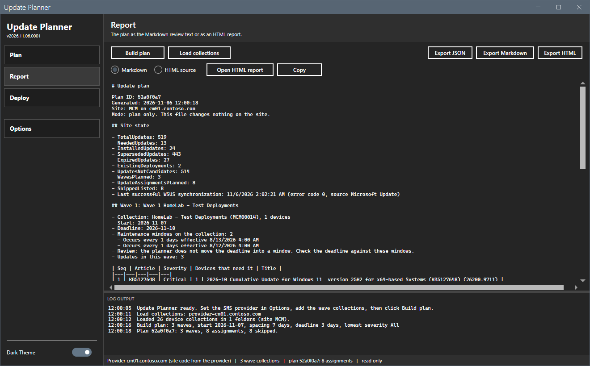
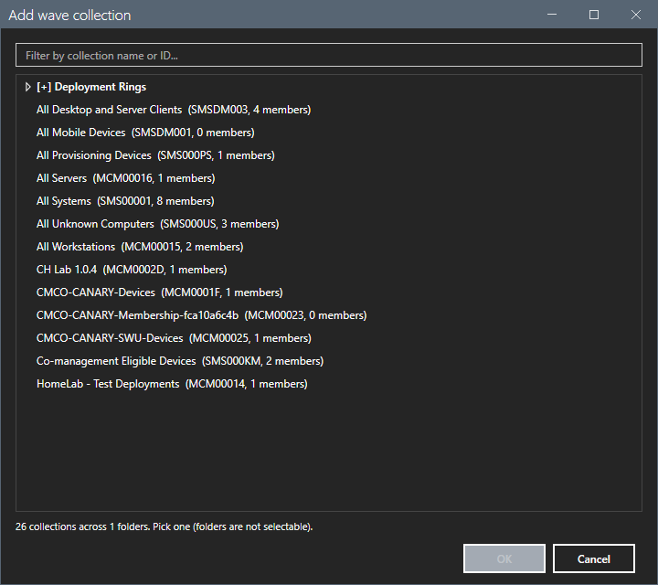
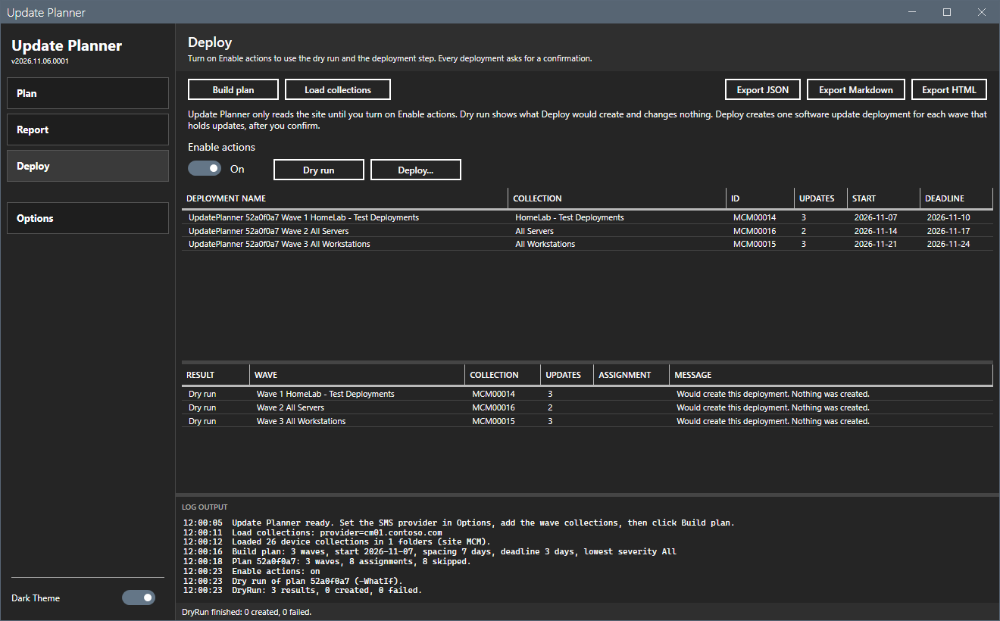
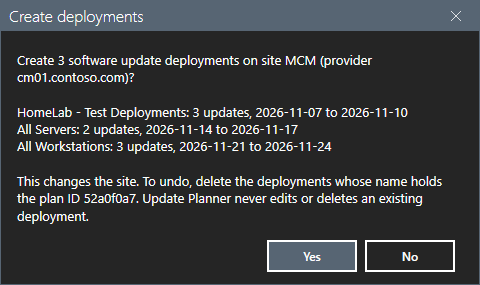

# Update Planner

[](https://github.com/jasonulbright/update-planner/releases/latest)
[](https://github.com/jasonulbright/update-planner/releases)
[](#requirements)
[](LICENSE)

Plan software update rollouts for a Configuration Manager site. Pick the wave collections, set the dates, and get a plan: which updates go to which collection, in which order, in which wave, and on which dates. Review the plan as a grid or as a report, export it, and create the deployments only when you choose to.



## Features

- Pick the wave collections from a searchable console folder tree. The order of the list is the order of the waves.
- Set the start date of wave 1, the days between waves, the days to the deadline, the lowest severity and the most updates in a wave.
- Build the plan without changing the site. The plan reads the update catalog, the update need of each collection, the maintenance windows and the existing deployments.
- Review the plan in a grid, in the Markdown review text or in an HTML report. A second grid lists each skipped update and the reason.
- Export the plan as JSON, Markdown or HTML.
- Deploy behind an **Enable actions** switch. A dry run runs the deploy step with `-WhatIf` and creates nothing. **Deploy...** asks for a confirmation that lists every deployment before it creates one.
- Built-in collections (an ID that starts with `SMS`) are blocked as a deploy target.
- Every dry run and every deploy writes one record to `Logs\update-planner-actions.jsonl`.
- Dark and light themes with a runtime toggle, like the other tools of the AppPackager Suite.

## Requirements

- Windows 10 / 11 or Server 2016+
- PowerShell 5.1 (PowerShell 7 also works)
- .NET Framework 4.7.2+
- Network access to the SMS Provider computer (WinRM, CIM)
- The Windows account that runs the tool needs read access to the site (the Read-only Analyst role is enough to build a plan). The Deploy step needs the right to create software update deployments.
- The Configuration Manager console is not needed.

The tool connects with the Windows account that runs it. It stores no password and has no credential field.

## Quick Start

1. Download the release zip and extract it to a working folder.
2. Right-click `start-updateplanner.ps1` -> **Run with PowerShell**, or from a PowerShell prompt:

   ```powershell
   powershell -ExecutionPolicy Bypass -File start-updateplanner.ps1
   ```
3. Click **Options** and set the SMS Provider FQDN. The site code is optional; the tool reads it from the provider when it is empty.
4. On the **Plan** view, click **Add...**. The first click loads the device collections. Pick each wave collection in rollout order.
5. Set the dates and click **Build plan**.

Inside the AppPackager Suite, the launcher hands its site code and provider to the tool.

## Layout

The shell has a sidebar with three views and an Options dialog:

- **Plan** -- wave collections, dates and settings on top. Two tabs below: *Planned updates* (one row for each update in each wave) and *Skipped updates* (the reason for each).
- **Report** -- the plan as Markdown or HTML source. **Open HTML report** writes the page to `Reports\` and opens it in the default browser. **Copy** copies the text.
- **Deploy** -- the Enable actions switch, **Dry run**, **Deploy...**, the deployments that the plan would create, and the result of the last run.





## Collection picker

**Add...** opens the same collection picker as the other suite tools. Folders are not selectable. The filter box narrows the tree by name or ID.



## Deploy

Update Planner only reads the site until **Enable actions** is on. With the switch on, **Dry run** and **Deploy...** work.

- **Dry run** runs the deploy step with `-WhatIf`. The grid shows each deployment that the step would create. Nothing is created.
- **Deploy...** shows a confirmation with the number of deployments, the site, the provider and each wave. After **Yes**, the tool creates one software update deployment for each wave that holds updates. Each deployment is named `UpdatePlanner <PlanId> <wave name>`.
- To undo a run, delete the deployments whose name holds the plan ID. The tool never edits or deletes an existing deployment.
- The tool does not create software update groups or deployment packages and does not download content. Review a created deployment in the console before a real rollout. See [docs/plan-rules.md](docs/plan-rules.md).





## Command line

The window wraps the same module as the script `Invoke-UpdatePlanner.ps1`. The script writes `update-plan.json` and `update-plan.md` and supports `-Apply`, `-WhatIf` and `-Confirm`:

```powershell
.\Invoke-UpdatePlanner.ps1 -ComputerName cm01.contoso.com -TargetCollection 'Pilot', 'Broad' -StartDate 2026-11-09
.\Invoke-UpdatePlanner.ps1 -ComputerName cm01.contoso.com -TargetCollection 'Pilot', 'Broad' -Apply -WhatIf
```

## Files written on disk

| File | Purpose |
|------|---------|
| `UpdatePlanner.prefs.json` | Site code, SMS provider, the last settings and the wave list |
| `UpdatePlanner.windowstate.json` | Window size, position and last-used view |
| `Logs\UpdatePlanner-*.log` | Per-session tool log |
| `Logs\update-planner-actions.jsonl` | One record for each dry run and each deploy |
| `Reports\*` | Plan exports |

## Tests

```powershell
.\Invoke-Checks.ps1
```

The script runs PSScriptAnalyzer with the shared settings, then the Pester tests. The tests need no lab. CI runs the tests under Windows PowerShell 5.1 and PowerShell 7.

## Project Structure

```
update-planner/
+- start-updateplanner.ps1          # WPF shell
+- MainWindow.xaml                  # Main window layout
+- Invoke-UpdatePlanner.ps1         # Command line entry point
+- Invoke-Checks.ps1                # Linter and tests
+- Lib/                             # Vendored MahApps.Metro 2.4.10
|  \- SuiteCommon/                  # Vendored shared core: logging, settings, theme, dialogs
+- Module/
|  +- UpdatePlannerCommon.psd1      # Module manifest
|  \- UpdatePlannerCommon.psm1      # Plan logic and window support
+- Tests/                           # Pester 5 tests
+- docs/plan-rules.md               # Plan rules and limits
```

## License

MIT. See [LICENSE](LICENSE). Third-party notices: [THIRD-PARTY-NOTICES.md](THIRD-PARTY-NOTICES.md).
