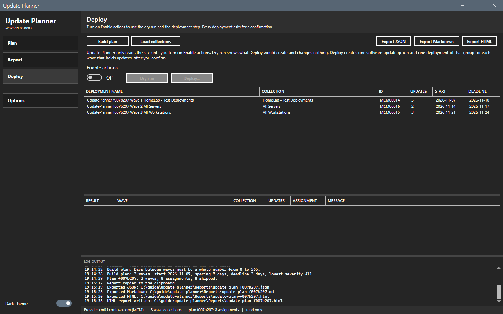
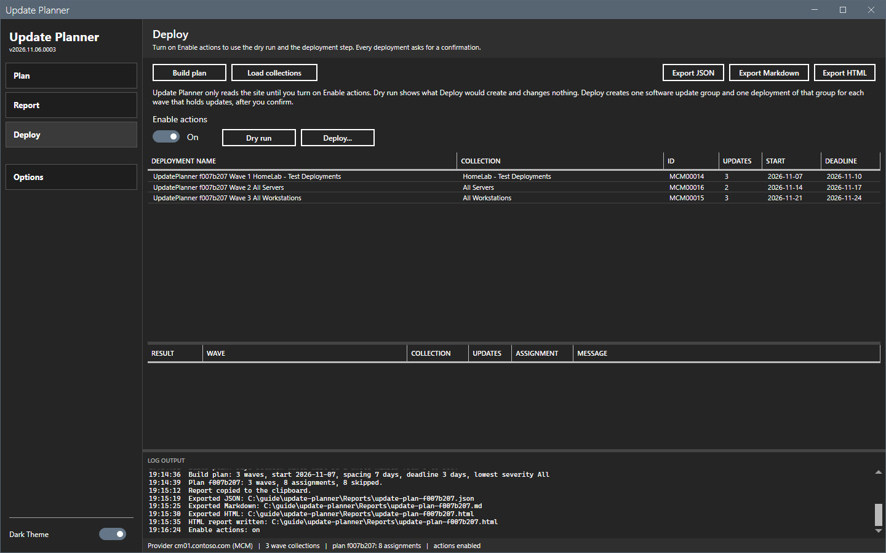
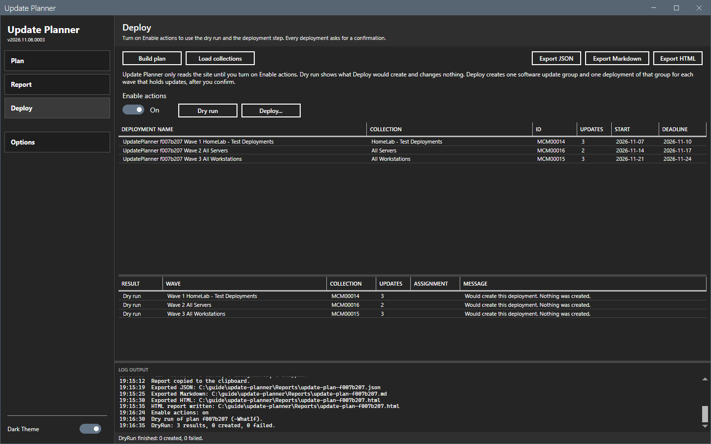
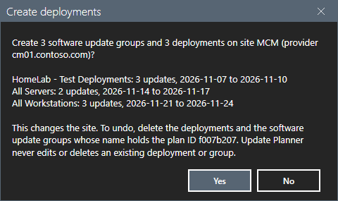
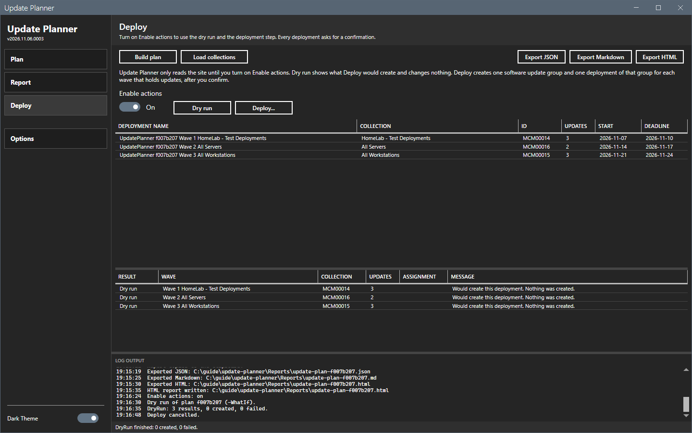
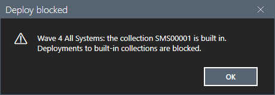
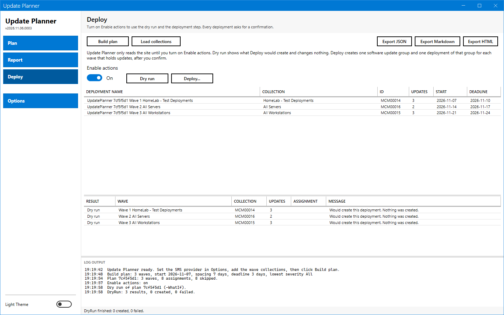
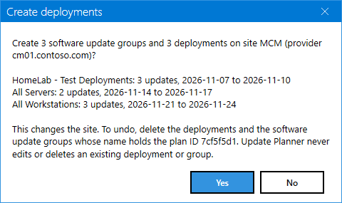

# Deploy page

The Deploy page runs the only step that changes the site. It creates one software update group and one deployment of that group for each wave that holds updates.

## What it does

The page shows the deployments that the plan would create. **Dry run** runs the deploy step with `-WhatIf` and creates nothing. **Deploy...** asks for a confirmation, then creates the deployments. Both buttons stay off until you turn on **Enable actions**.

The tool never edits or deletes an existing deployment or group. It does not create deployment packages, and it does not download content.

## When to use it

- Use **Dry run** to see what the plan would create.
- Use **Deploy...** only after you reviewed the plan and the report.

## Requirements

- A plan.
- **Enable actions** is on.
- For **Deploy...**: a right to create software update deployments on the site.
- No wave targets a built-in collection. See below.

## Steps

### See the deployments that the plan would create

1. Build a plan.
2. Select **Deploy** in the sidebar.
3. Read the upper grid. It has one row for each wave that holds updates.

Each deployment, and its software update group, is named `UpdatePlanner <plan ID> Wave <n> <collection name>`. The grid shows the collection, its ID, the number of updates, the start and the deadline.

### Run a dry run

1. Select the **Enable actions** switch. It shows **On**.
2. Select **Dry run**. The overlay shows "Running the deploy step with -WhatIf...".
3. Read the lower grid. Each row shows **Dry run** in **Result** and the message "Would create this deployment. Nothing was created."
4. Read the log. It ends with "DryRun: 3 results, 0 created, 0 failed."

A dry run writes one record to the action log. See [Files and logs](../reference/files-and-logs.md).

### Create the deployments

1. Select **Deploy...**. A confirmation shows the number of software update groups and deployments, the site, the provider and one line for each wave.
2. Read the text. It names the change: "This changes the site." It also tells how to undo it: delete the deployments and the software update groups whose name holds the plan ID.
3. Select **Yes** to create the deployments. Select **No** to stop. The log writes "Deploy cancelled."

After **Yes**, the lower grid shows one row for each wave with **Created** and the assignment ID, or **Failed** and the message. The status bar shows "Apply finished: <n> created, <n> failed." The action log gets one record.

To undo a run, delete the deployments and the software update groups whose name holds the plan ID. Review a created deployment in the console before a real rollout.

### Deploy to a built-in collection

A wave that targets a built-in collection (an ID that starts with `SMS`) blocks **Deploy...**.

1. Add a built-in collection, for example All Systems, as a wave. Build the plan.
2. Select **Deploy** in the sidebar. Turn on **Enable actions**.
3. Select **Deploy...**. A message names the wave and the collection. The log writes "Deploy blocked:" with the same text. Nothing is created.

**Dry run** still works for such a plan. The plan shows what the deployment would target.

### Deploy page in the light theme

## Options and settings of this page

| Control | Default | Effect |
|---|---|---|
| **Enable actions** | Off | Turns on **Dry run** and **Deploy...**. The state is not saved. The tool starts with the switch off. |
| **Dry run** | - | Runs the deploy step with `-WhatIf`. Creates nothing. |
| **Deploy...** | - | Asks for a confirmation, then creates the deployments. |

A group holds the update IDs of the wave. The deployment of the group sets the collection, the start time, the deadline (required), notification on and local time. The deployment does not allow installation or restart outside the maintenance window after the deadline. See [Plan rules](../reference/plan-rules.md). See [Plan rules](../reference/plan-rules.md).

The status bar shows "actions enabled" or "read only".

## Limits

- **Yes** is the default button of the confirmation. Pressing Enter creates the deployments.
- The tool creates deployments only for waves that hold updates.
- A time zone difference can show another clock time on the site server. See [Plan rules](../reference/plan-rules.md).

## Troubleshooting

| Message | Cause | Fix |
|---|---|---|
| Dry run and Deploy... are off. | **Enable actions** is off, or no plan exists. | Build a plan and turn on **Enable actions**. |
| Deploy blocked: Wave 4 All Systems: the collection SMS00001 is built in. Deployments to built-in collections are blocked. | A wave targets a built-in collection. | Remove the wave and build the plan again. |
| Failed ... in the **Result** column | The site refused a deployment. The **Message** column shows the reason. | Note the plan ID and read every result. A software update group of that wave can exist without a deployment: check the console and delete the unused group. Fix the cause. Build the plan again. Review every wave before you deploy again. |

## Links

- [Manually deploy software updates](https://learn.microsoft.com/intune/configmgr/sum/deploy-use/manually-deploy-software-updates): Describes how to deploy software updates.
- [Monitor software updates](https://learn.microsoft.com/intune/configmgr/sum/deploy-use/monitor-software-updates): Describes how to check the state of a deployment.
