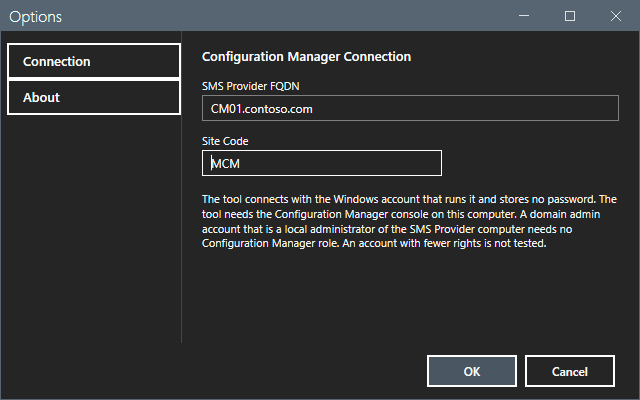
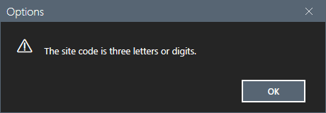
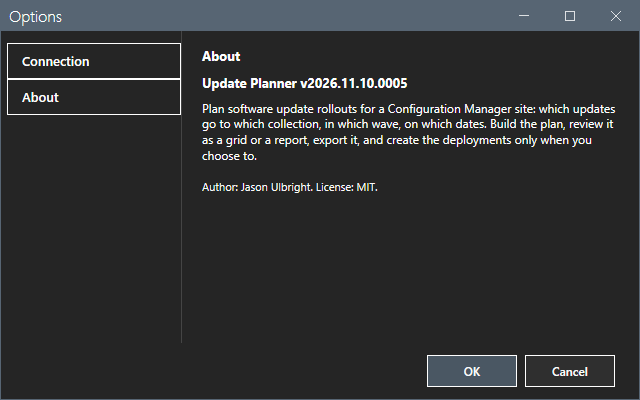
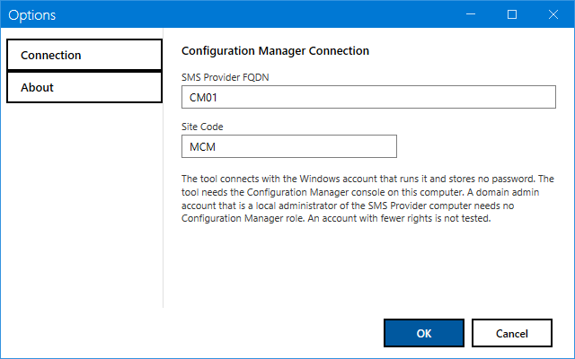

# Options dialog

The Options dialog sets the connection to the site and shows the version of the tool.

## What it does

The dialog has two sections, **Connection** and **About**. **Connection** holds the SMS Provider and the site code. **About** shows the version, a one-paragraph description, the author and the license.

## When to use it

Use the dialog at the first start, and when the SMS Provider or the site changes.

## Requirements

None. The dialog does not connect to the site.

## Steps

### Set the connection

1. Select **Options** in the sidebar. The button is off while a step runs.
2. Select **Connection**.
3. In **SMS Provider FQDN**, enter a computer name or an FQDN. The characters are letters, digits, dot, hyphen and underscore. The watermark shows `e.g. cm01.contoso.com`.
4. In **Site Code**, enter the three letters or digits of the site code, for example `MCM`. The site code is required.
5. Select **OK**. Select **Cancel** to discard the change. Press Esc to cancel.

If the site code has the wrong form, a message shows "The site code is three letters or digits." The dialog stays open.

The message boxes of the dialog carry the title **Update Planner**. They open in the center of the dialog. A change of the provider or the site code clears the collection list, the plan, the grids and the report. The wave list stays. Load the collections and build the plan again. After a change of site, check each wave that stays: remove it and select it again when its collection is not the one that you mean.

### Read the version

1. Select **About**.
2. Read the version, for example `Update Planner v2026.11.06.0003`.

### Options in the light theme

## Options and settings of this page

| Control | Default | Effect |
|---|---|---|
| **SMS Provider FQDN** | Empty, or the value that the suite launcher hands over | The computer that runs the SMS Provider. Saved when you select **OK**. |
| **Site Code** | Empty, or the value that the suite launcher hands over | A three-character site code. Required. The tool no longer asks the provider for it. |

The text on the page says that the tool needs the Configuration Manager console on this computer, and that a domain admin account that is a local administrator of the SMS Provider computer needs no Configuration Manager role. This is the text of the dialog. It was tested on the lab only. An account with other rights is not tested. Check the roles and the scopes of the account in your site.

## Limits

- The dialog has no credential field. To use another account, start the tool as that account.
- A provider name that holds a query or a path is refused.

## Troubleshooting

| Message | Cause | Fix |
|---|---|---|
| The site code is three letters or digits. | The site code has another form. | Enter three letters or digits. |
| The SMS provider is a computer name or an FQDN. | The provider holds a character that a name does not hold. | Enter a computer name or an FQDN. |

## Links

- [Plan for the SMS Provider](https://learn.microsoft.com/intune/configmgr/core/plan-design/hierarchy/plan-for-the-sms-provider): Explains what the SMS Provider is and where it runs.
