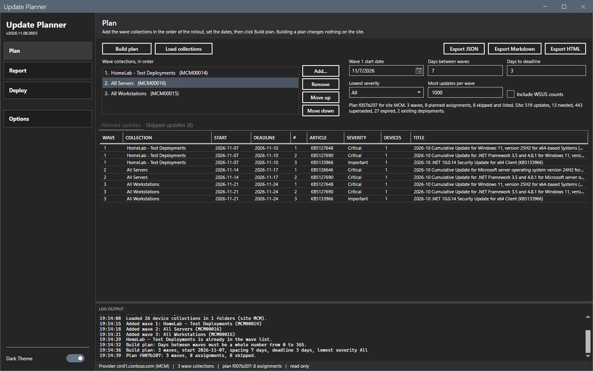
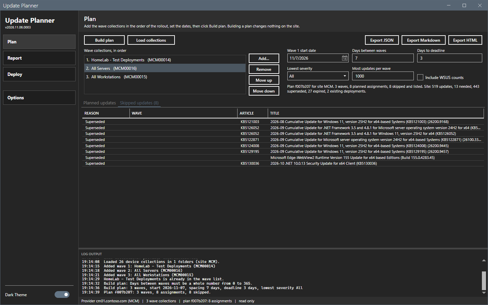
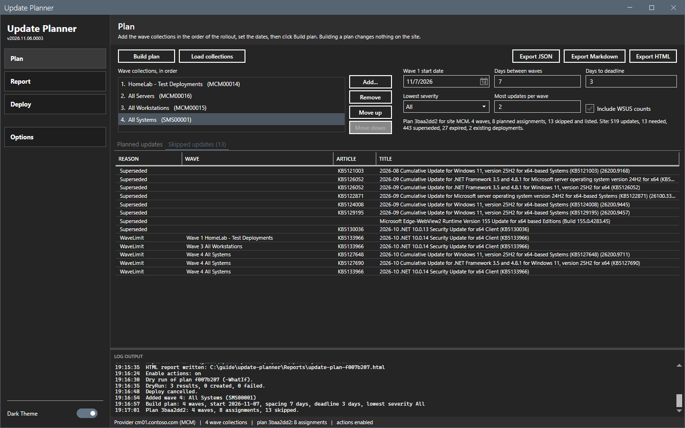
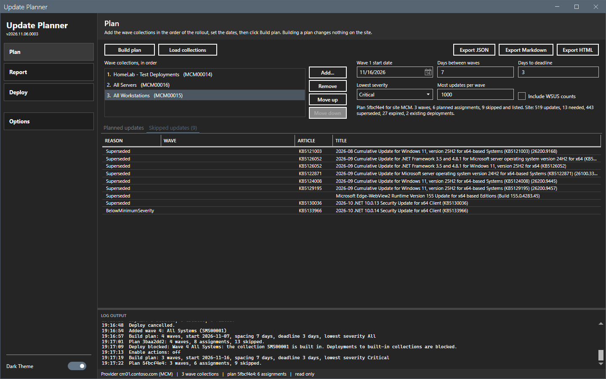
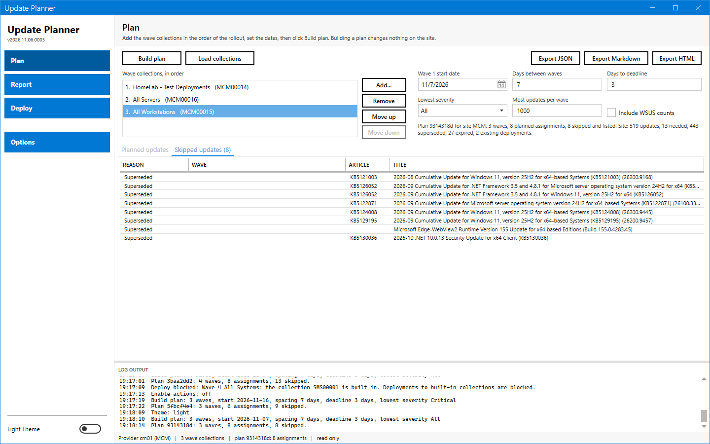

# Plan grids

The two grids on the Plan page show the result of Build plan. The summary text above them gives the totals.

## What it does

The **Planned updates** grid has one row for each update in each wave. The **Skipped updates** grid has one row for each skipped update that the plan lists, with the reason.

## When to use it

- Use **Planned updates** to check what goes to which collection and on which dates.
- Use **Skipped updates** to find out why an update that you expect is not in a wave.

## Requirements

A plan. Both grids are empty until you select **Build plan**.

## Steps

### Read the planned updates

1. Select **Build plan** on the Plan page.
2. Select the **Planned updates** tab.
3. Read one row for each update in each wave.

A title that is longer than its column ends with an ellipsis. Hold the pointer over the title to read the full title in a tooltip. The Markdown and the HTML report hold the full titles.

### Read the skipped updates

1. Select the **Skipped updates** tab. The tab header shows the number of skipped updates that the plan lists, for example **Skipped updates (8)**.
2. Read the **Reason** of each row.

A wave limit adds rows with the reason `WaveLimit` and the wave of the update.

A lowest severity adds rows with the reason `BelowMinimumSeverity`.

In the light theme, the grids use the same columns.

## Options and settings of this page

### Columns of Planned updates

| Column | Content |
|---|---|
| **Wave** | The number of the wave. |
| **Collection** | The name of the wave collection. |
| **Start** | The start date of the wave, `yyyy-MM-dd`. |
| **Deadline** | The start date plus **Days to deadline**. |
| **#** | The place of the update in the wave. |
| **Article** | `KB` and the article ID. The cell is empty when the update has no article. |
| **Severity** | Critical, Important, Moderate, Low or the name that the site gives. |
| **Devices** | How many devices of the wave collection need the update. |
| **Title** | The update title. |

The order inside a wave is severity (high to low), then devices (high to low), then article ID, then CI ID.

### Columns of Skipped updates

| Column | Content |
|---|---|
| **Reason** | The reason code. See the table below. |
| **Wave** | The wave that skipped the update. Empty when no wave applies. |
| **Article** | `KB` and the article ID. |
| **Title** | The update title. |

### Reasons

| Reason | Meaning | Listed |
|---|---|---|
| `Superseded` | A newer update replaces the update. The tool lists it when a device still needs it. | Yes, with no wave. |
| `BelowMinimumSeverity` | The severity is below **Lowest severity**. | Yes, with no wave. |
| `AlreadyDeployed` | A deployment already targets the update at the wave collection. | Yes, with the wave. |
| `WaveLimit` | The wave holds **Most updates per wave** updates. | Yes, with the wave. |
| `Expired`, `NotNeeded` | The update is expired, or no device needs it. | No. The summary counts them. |

### Summary text

`Plan <ID> for site <code>. <n> waves, <n> planned assignments, <n> skipped and listed. Site: <n> updates, <n> needed, <n> superseded, <n> expired, <n> existing deployments.`

## Limits

- The grids are read-only. You cannot sort or edit a row.
- The grids show the plan of the last Build plan. A change of a setting does not change them until you build again.

## Troubleshooting

| Message | Cause | Fix |
|---|---|---|
| The Planned updates grid is empty and the summary says 0 planned assignments. | No device in a wave collection needs an update, or the lowest severity is too high. | Read the **Skipped updates** grid and the site totals in the summary. Add a wave collection with devices, or lower **Lowest severity**. |
| The skipped update has no wave. | The skip applies to the whole plan, not to one wave. | None. |

## Links

- [Manually deploy software updates](https://learn.microsoft.com/intune/configmgr/sum/deploy-use/manually-deploy-software-updates): Describes how to create a software update deployment.
