# Plan page

The Plan page holds the wave collections, the dates, the settings and the two result grids. It builds the plan.

## What it does

The page turns a list of device collections and five settings into a plan. Collection 1 is wave 1, collection 2 is wave 2, and so on. Build plan reads the site and shows the result in two grids. It changes nothing on the site.

## When to use it

- Use it to plan the order and the dates of a software update rollout.
- Use it again after you change a setting, a wave or the connection.

## Requirements

- The connection is set in **Options**. See [Options dialog](options.md).
- The Configuration Manager console is installed on this computer (the ConfigurationManager module).
- The account is a local administrator of the SMS Provider computer.
- At least one wave collection.

## Steps

### Load the collections

1. Select **Load collections**. A progress overlay shows "Reading device collections and console folders...".
2. Read the log. It ends with "Loaded 26 device collections in 1 folders (site MCM)." with your numbers.

**Add...** loads the collections by itself the first time. **Options** loads them again when you change the provider or the site code.

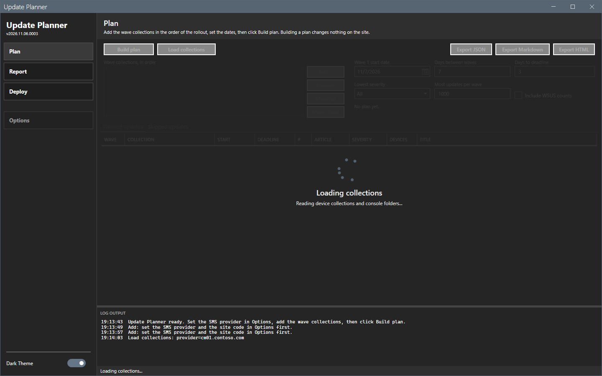

### Add a wave collection

1. Select **Add...**. The **Add wave collection** picker opens.
2. In the filter box, enter part of a collection name or an ID. The tree shows only the matches, and the status line under the tree shows how many match.
3. Select a collection. **OK** turns on only for a collection. A folder is not selectable.
4. Select **OK**. The collection is the last wave.

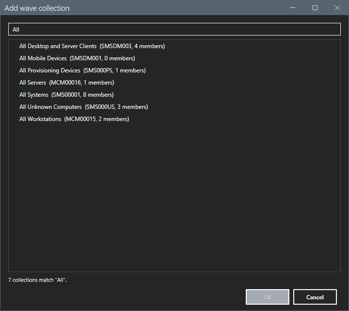

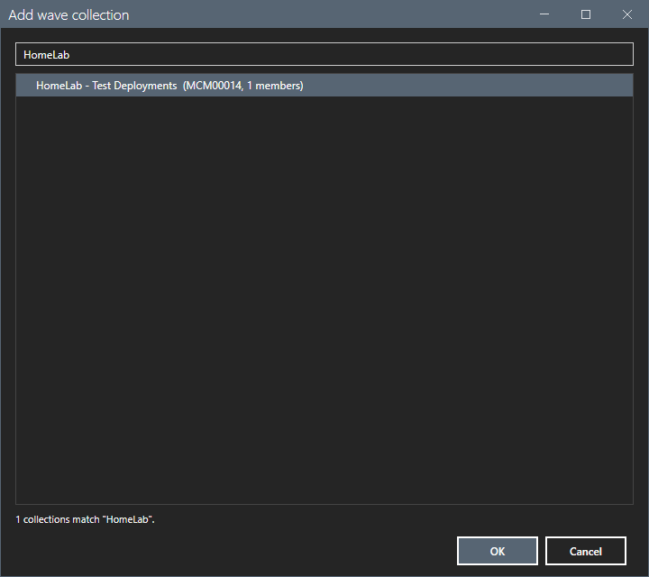

The picker lists the collection name, the ID and the member count. The wave list shows a number, the name and the ID, for example `1.  HomeLab - Test Deployments   (MCM00014)`.

A collection that is in the list twice is refused. The log writes "<name> is already in the wave list."

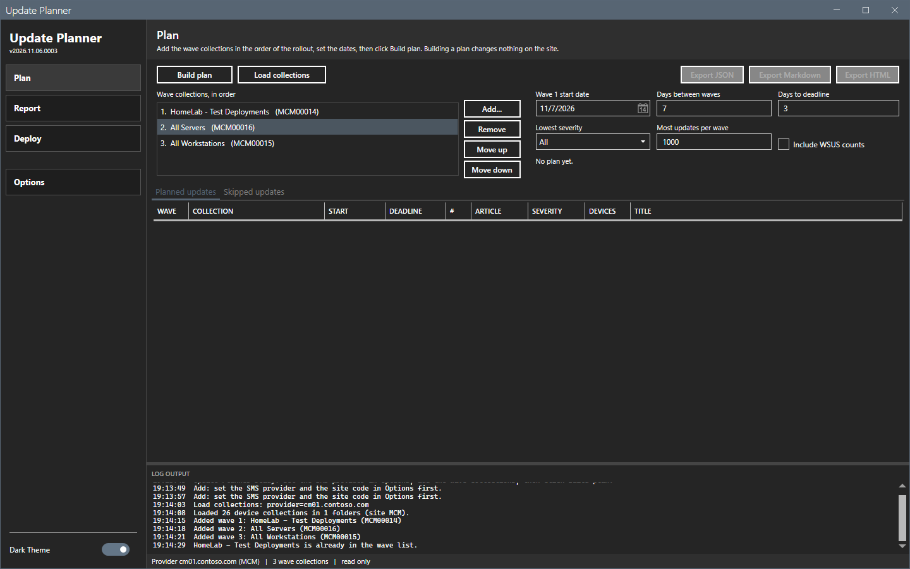

### Change the order of the waves

1. Select a wave in the list.
2. Select **Move up** or **Move down**. **Move up** is off for wave 1. **Move down** is off for the last wave.
3. To remove a wave, select it and select **Remove**.

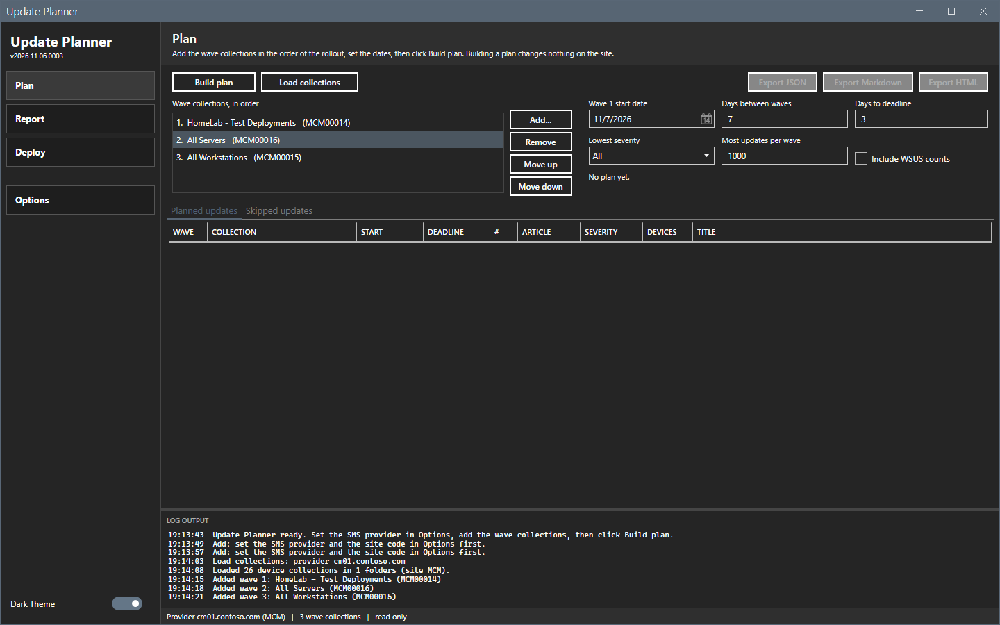

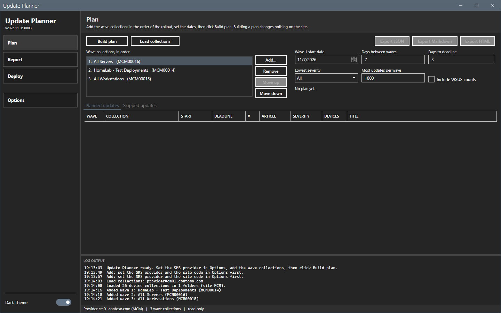

The order of the list is the order of the waves. Build the plan again after a change.

### Set the dates and the filters

| Control | Default | Effect |
|---|---|---|
| **Wave 1 start date** | Tomorrow | The start date of wave 1. Wave n starts on this date plus (n - 1) times **Days between waves**. Type a date in the box or select a date in the calendar. The box shows the date in the format of your Windows region. The grids show it as `yyyy-MM-dd`. |
| **Days between waves** | 7 | A whole number from 0 to 365. |
| **Days to deadline** | 3 | A whole number from 0 to 365. The deadline of a wave is its start date plus this number of days. |
| **Lowest severity** | All | **All**, **Low**, **Moderate**, **Important** or **Critical**. An update below the lowest severity is skipped and listed. |
| **Most updates per wave** | 1000 | A whole number from 1 to 1000. The updates over the limit are skipped and listed with the reason `WaveLimit`. |
| **Include WSUS counts** | Cleared | Also reads update counts from the WSUS server on the provider computer. The counts go to the report. They do not change the plan. |

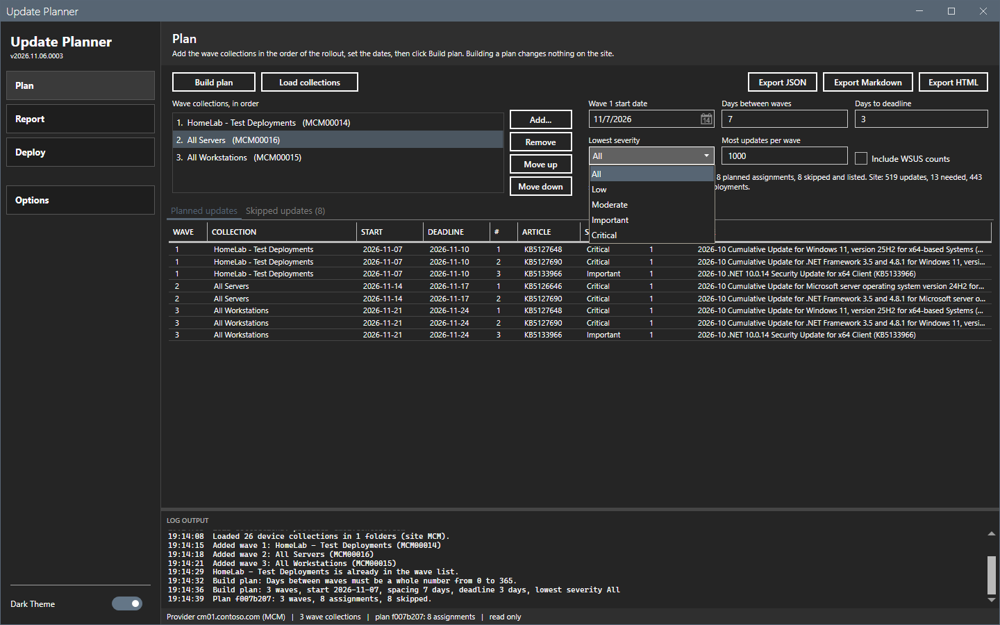

### Build the plan

1. Select **Build plan**. The overlay shows "Connecting to the SMS Provider...", then "Reading updates, collections and deployments...", then "Building the waves...".
2. Read the summary under the settings. It shows the plan ID, the site code, the number of waves, the planned assignments and the skipped updates. It also shows the site totals: updates, needed, superseded, expired and existing deployments.
3. Read the **Planned updates** and **Skipped updates** grids. See [Plan grids](plan-grids.md).

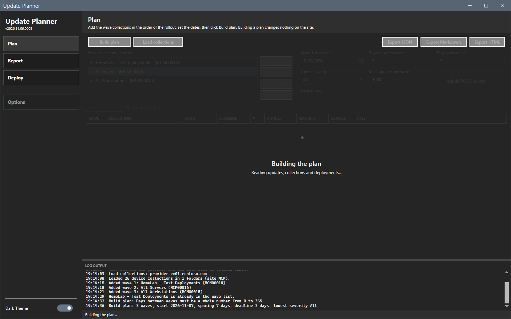

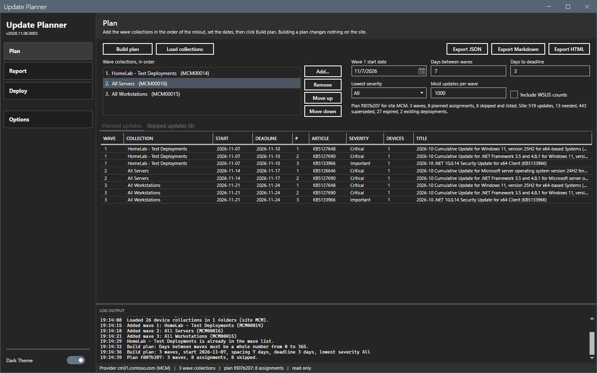

The plan ID is eight characters. It changes at each build.

If a setting is wrong, the tool does not build. A message lists each wrong value, and the log writes the same text.

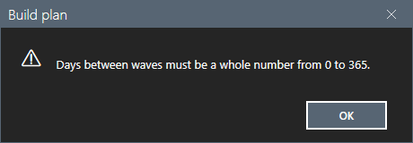

### Plan for a collection that targets everything

A built-in collection (an ID that starts with `SMS`, for example All Systems, `SMS00001`) is a valid wave in a plan. The plan builds. **Deploy...** refuses it. See [Deploy page](deploy.md).

1. Add the built-in collection as a wave.
2. Select **Include WSUS counts** if you want the WSUS counts in the report.
3. Select **Build plan**.

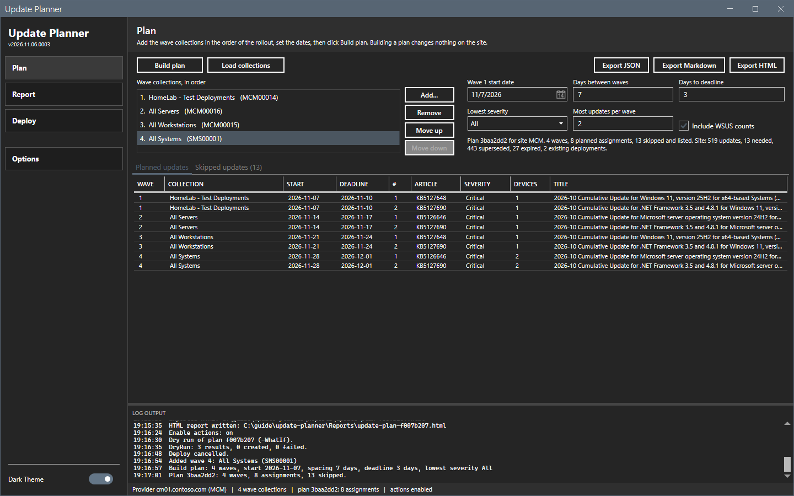

### Filter by severity

1. In **Lowest severity**, select **Critical**.
2. Select **Build plan**. Each update below **Critical** is skipped with the reason `BelowMinimumSeverity`.

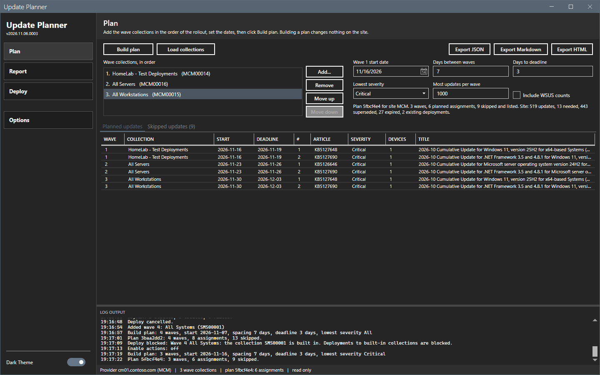

### Change the connection

The Options dialog clears the plan when you change the provider or the site code. The image shows the page after a change of the provider. The grids and the summary go back to empty, the Skipped updates header goes back to "Skipped updates", and **Export** buttons turn off.

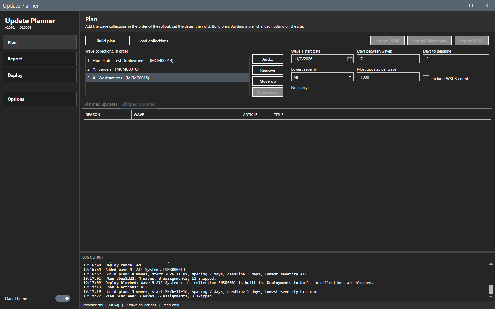

## Options and settings of this page

### Buttons

| Button | Effect |
|---|---|
| **Build plan** | Reads the site and builds the plan. |
| **Load collections** | Reads the device collections and the console folders. |
| **Add...** | Opens the picker. |
| **Remove**, **Move up**, **Move down** | Change the wave list. They turn on when a wave is selected. |
| **Export JSON**, **Export Markdown**, **Export HTML** | Save the plan. They turn on when a plan exists. See [Report and export](report-and-export.md). |

### Saved choices

The tool saves the settings, the connection and the wave list when you build a plan and when you close the window. It does not save the plan or the wave 1 start date. The start date is tomorrow at each start. A plan that you build again can have another date. [Settings](../reference/settings.md) lists the keys.

### Light theme

The toggle at the bottom of the sidebar changes between **Dark Theme** and **Light Theme**. The choice is saved at once.

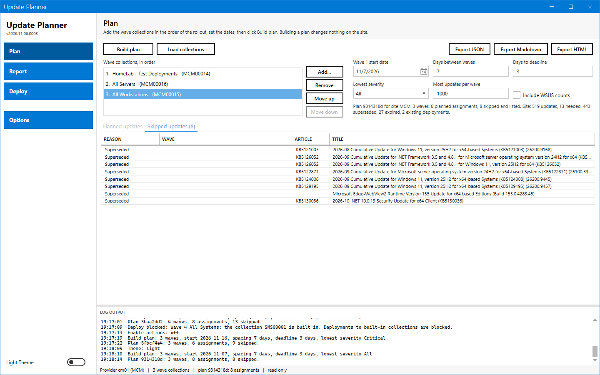

## Limits

- A busy step turns off the buttons that start another step.
- A very large site returns many rows. See [Plan rules](../reference/plan-rules.md).

## Troubleshooting

| Message | Cause | Fix |
|---|---|---|
| Add: set the SMS provider and the site code in Options first. | The provider or the site code is empty. | Set both in **Options**. |
| Days between waves must be a whole number from 0 to 365. | The box holds text or a number outside the range. | Enter a whole number from 0 to 365. |
| Failed: ... | The site query failed. The same text is in a dialog. | See [Error messages](../reference/error-messages.md). |

## Links

- [Introduction to software updates in Configuration Manager](https://learn.microsoft.com/intune/configmgr/sum/understand/software-updates-introduction): Explains the software update workflow.
- [Manually deploy software updates](https://learn.microsoft.com/intune/configmgr/sum/deploy-use/manually-deploy-software-updates): Describes how to create a software update deployment.
