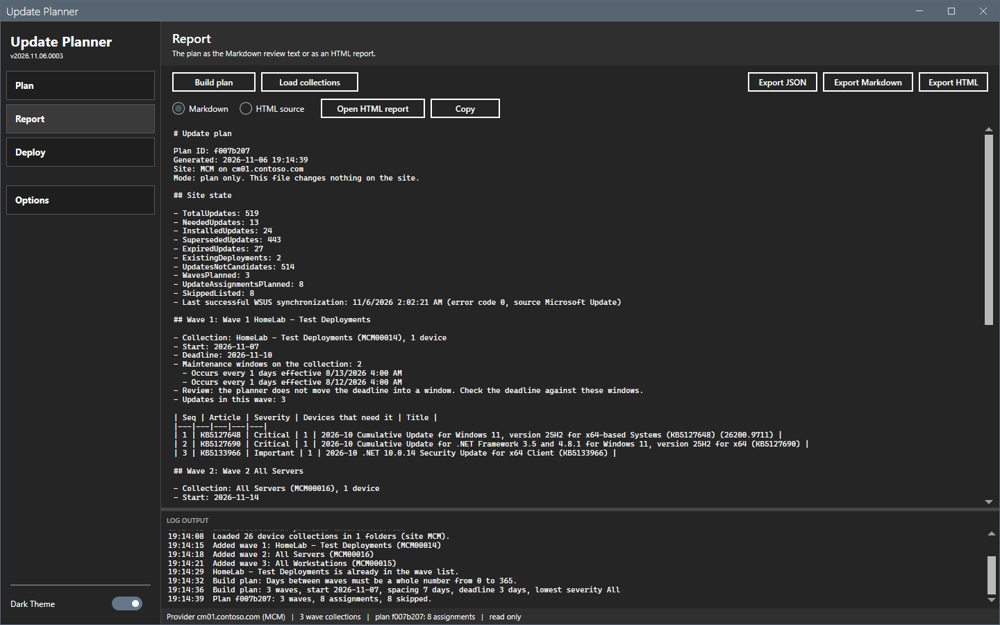
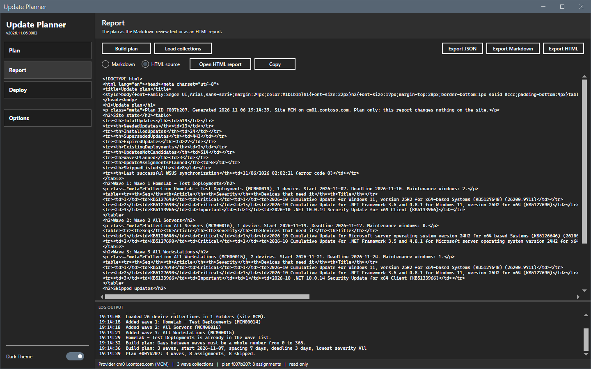
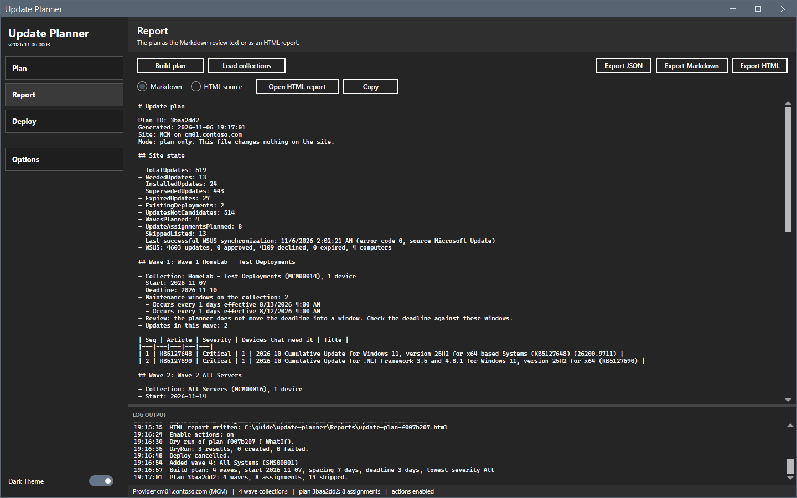
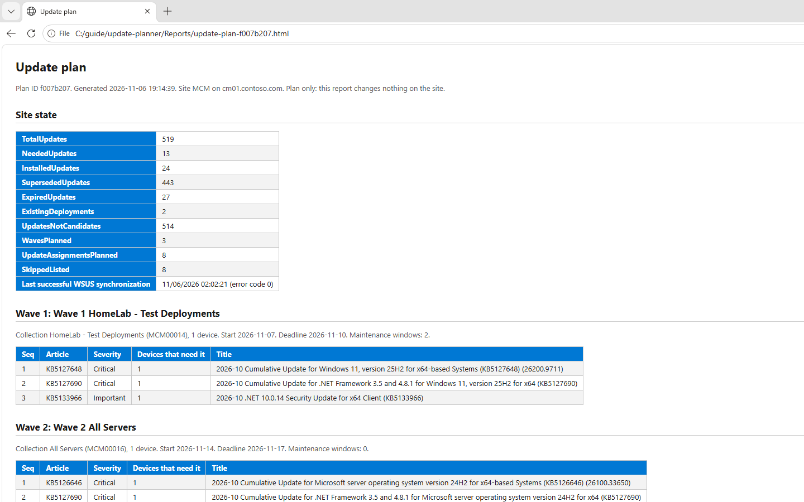
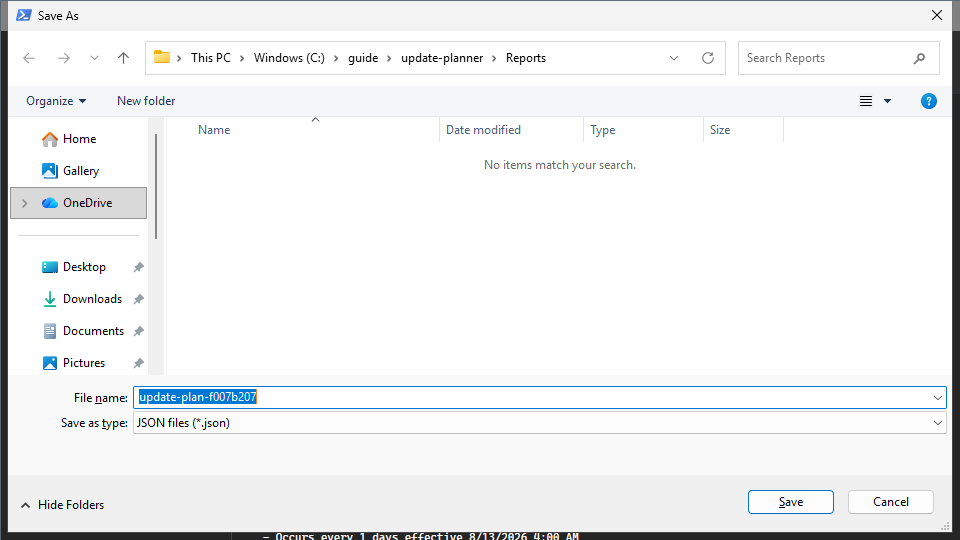
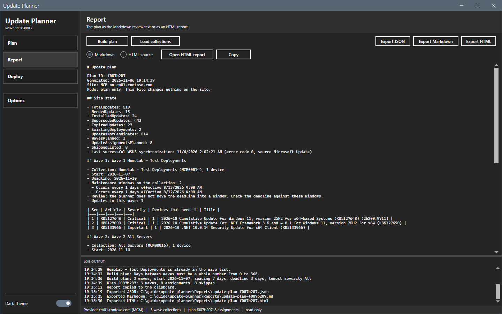
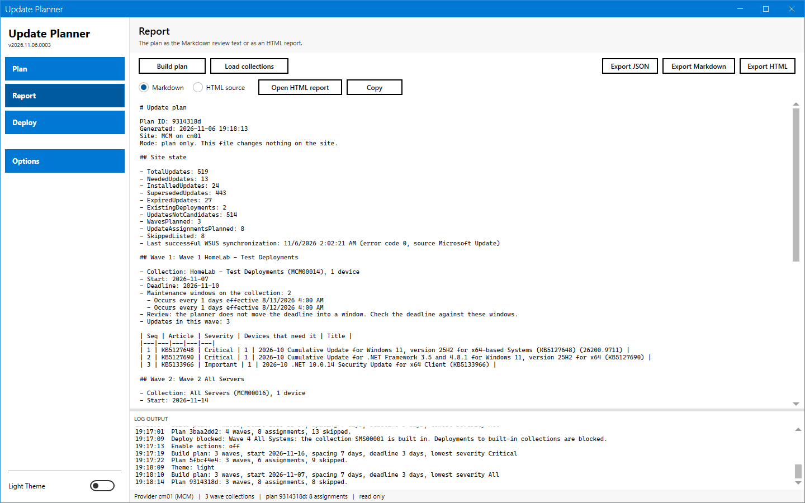

# Report and export

The Report page shows the plan as text. The three export buttons save the plan to a file.

## What it does

The Report page shows the review text of the plan in Markdown, or the source of the HTML report. **Open HTML report** writes the page to the `Reports` folder and opens it in the default browser. **Export JSON**, **Export Markdown** and **Export HTML** save the plan to a file that you choose.

## When to use it

- Use the report to review the plan with other people before you deploy.
- Use the JSON export to keep the plan as data.

## Requirements

A plan. Before **Build plan**, the page shows "Build a plan to see the report." and the buttons **Open HTML report**, **Copy** and the three export buttons are off.

## Steps

### Read the report

1. Select **Report** in the sidebar.
2. Select **Markdown** or **HTML source**.
3. Read the text. Use the scroll bar to move in it.

The Markdown report holds the plan ID, the generation time, the mode ("plan only"), the site state and one section for each wave. A wave section has the collection, the start, the deadline, the maintenance windows on the collection and a table of the updates. With **Include WSUS counts**, the site state also has a WSUS line.

### Copy the report

1. Select **Copy**. The log writes "Report copied to the clipboard."
2. Paste the text in a document or a mail.

The text is the text of the format that is selected.

### Open the HTML report

1. Select **Open HTML report**.
2. The tool writes `Reports\update-plan-<ID>.html` and opens it in the default browser. The log writes "HTML report written:" and the path.

The page has no script and no external resource. It changes nothing on the site.

### Export a plan

1. Select **Export JSON**, **Export Markdown** or **Export HTML**. The buttons are at the top right of every page.
2. In the **Save As** dialog, keep the name `update-plan-<ID>` or enter another. The dialog opens in the `Reports` folder.
3. Select **Save**. The log writes "Exported JSON:" (or Markdown, or HTML) and the path.

The export of a plan does not change the site. The JSON file is a Suite ring plan that Deployment Helper loads. It holds the whole plan and reads back to the same plan. See [Plan format](../reference/plan-format.md).

### Report in the light theme

## Options and settings of this page

| Control | Effect |
|---|---|
| **Markdown** | Shows the review text. This is the default. |
| **HTML source** | Shows the source of the HTML report. |
| **Open HTML report** | Writes the HTML file to `Reports` and opens it. |
| **Copy** | Copies the shown text to the clipboard. |
| **Export JSON**, **Export Markdown**, **Export HTML** | Save the file of that format. |

## Limits

- Dates in the file are calendar dates. See [Plan rules](../reference/plan-rules.md).
- The Markdown report writes "Occurs every 1 days effective ..." for a maintenance window. The text comes from the site and the tool does not change it.
- The heading of a wave reads "Wave 1: Wave 1 HomeLab - Test Deployments". The wave name starts with the word Wave and the number.

## Troubleshooting

| Message | Cause | Fix |
|---|---|---|
| Build a plan to see the report. | No plan exists yet, or a change of the connection cleared it. | Select **Build plan** on the **Plan** page. |

## Links

- [Use maintenance windows](https://learn.microsoft.com/intune/configmgr/core/clients/manage/collections/use-maintenance-windows): Explains how maintenance windows limit when updates install.
