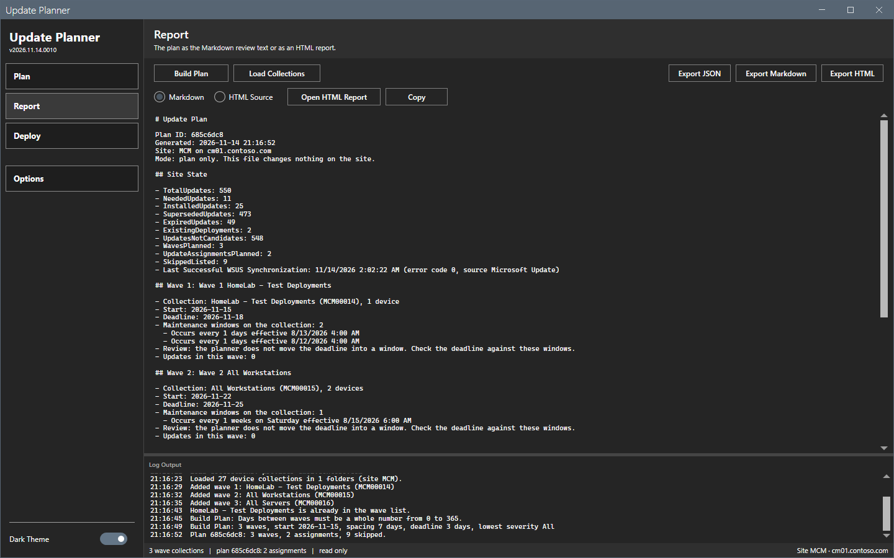
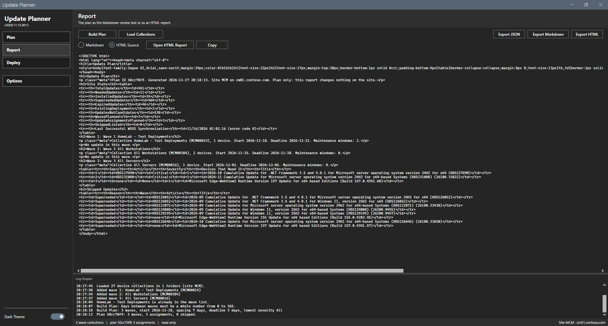
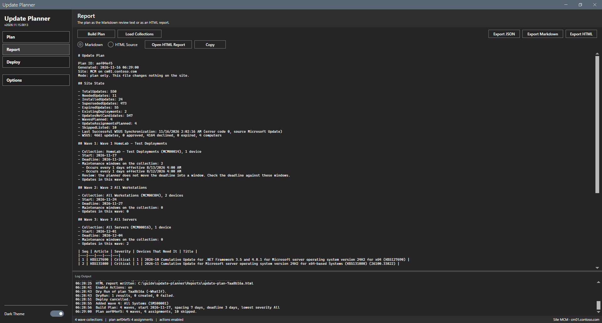
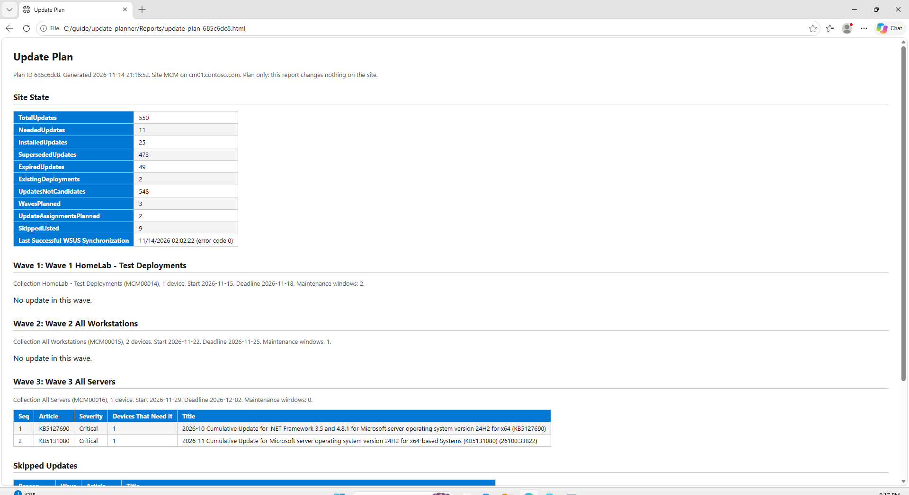
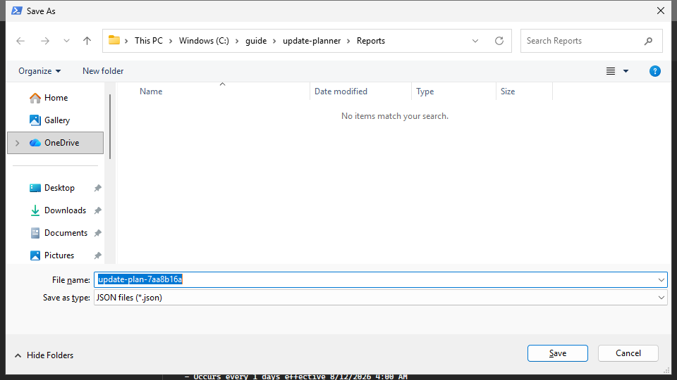
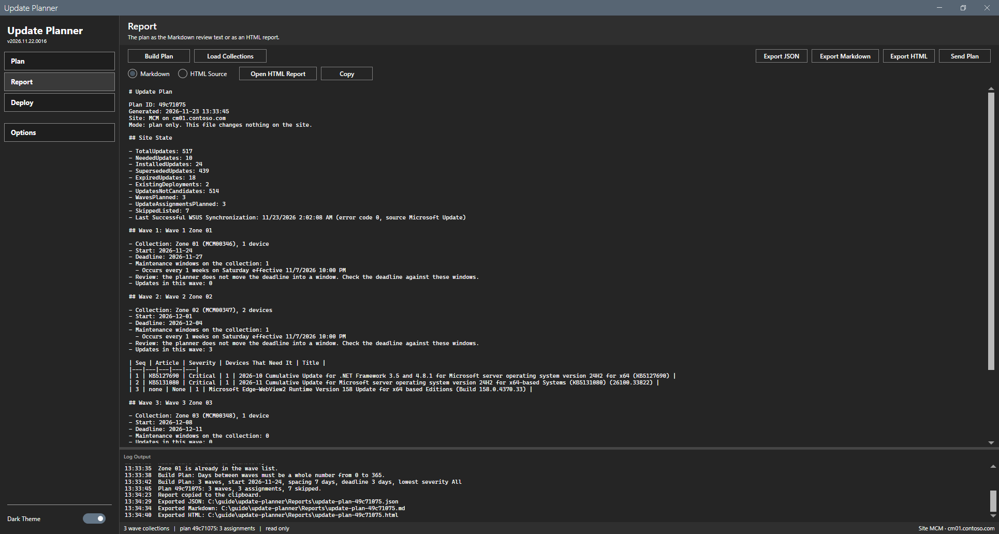
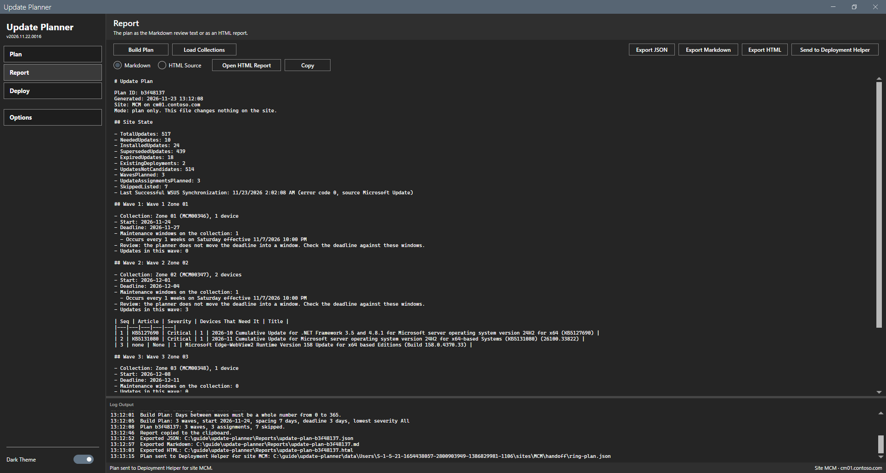
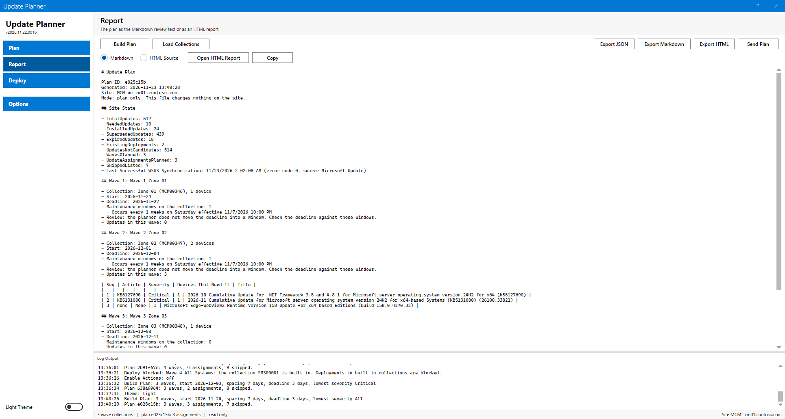

# Report and export

The Report page shows the plan as text. The three export buttons save the plan to a file.

## What it does

The Report page shows the review text of the plan in Markdown, or the source of the HTML report. **Open HTML Report** writes the page to the reports folder of the site and opens it in the default browser. **Export JSON**, **Export Markdown** and **Export HTML** save the plan to a file that you choose.

## When to use it

- Use the report to review the plan with other people before you deploy.
- Use the JSON export to keep the plan as data.

## Requirements

A plan. Before **Build Plan**, the page shows "Build a plan to see the report." and the buttons **Open HTML Report**, **Copy** and the three export buttons are off.

## Steps

### View the report

1. Select **Report** in the sidebar.
2. Select **Markdown** or **HTML Source**.
3. Review the text. Use the scroll bar to move in it.

The Markdown report holds the plan ID, the generation time, the mode ("plan only"), the site state and one section for each wave. A wave section has the collection, the start, the deadline, the maintenance windows on the collection and a table of the updates. With **Include WSUS Counts**, the site state also has a WSUS line.

### Copy the report

1. Select **Copy**. The log writes "Report copied to the clipboard."
2. Paste the text in a document or a mail.

The text is the text of the format that is selected.

### Open the HTML report

1. Select **Open HTML Report**.
2. The tool writes `update-plan-<ID>.html` in the reports folder of the site (`%LOCALAPPDATA%\AppPackagerData\sites\<SITE>\tools\update-planner\reports`, for example `sites\AB1\tools\update-planner\reports`) and opens it in the default browser. The log writes "HTML report written:" and the path.

The tool overwrites the file of the same plan ID without a question. Save an edited report under another name. The page has no script and no external resource. It changes nothing on the site.

### Export a plan

1. Select **Export JSON**, **Export Markdown** or **Export HTML**. The buttons are at the top right of every page.
2. In the **Save As** dialog, keep the name `update-plan-<ID>` or enter another. The dialog opens in the reports folder of the site.
3. Select **Save**. The log writes "Exported JSON:" (or Markdown, or HTML) and the path.

The export of a plan does not change the site. The JSON file is a Suite ring plan that Deployment Helper loads. It holds the whole plan and reads back to the same plan. See [Plan format](../reference/plan-format.md).

### Send the plan to Deployment Helper

1. Select **Send to Deployment Helper**. The button is at the top right of every page and turns on when a plan exists.
2. The tool writes the plan to the handoff folder of the site: `sites\<SITE>\handoff\ring-plan.json` in the data folder. The log writes "Plan sent to Deployment Helper for site" and the path. The status bar says the same.

Deployment Helper offers the plan in its Ring Deployment view with **Import Plan**. You do not copy a file by hand. The file is the Suite ring plan of **Export JSON** with three more fields: `Producer` (this tool and its version), `CreatedUtc` and `Site`. Deployment Helper shows them as the source, the age and the site of the plan, and marks a plan that is older than its stale limit. Each send replaces the file of the site. The folder holds one plan for each site and keeps no history. A send changes nothing on the site, and Deployment Helper deploys nothing until you validate and confirm there. The file holds names, ids, versions and dates only. It holds no credential.

### Report in the light theme

## Options and settings of this page

| Control | Effect |
|---|---|
| **Markdown** | Shows the review text. This is the default. |
| **HTML Source** | Shows the source of the HTML report. |
| **Open HTML Report** | Writes the HTML file to the reports folder of the site and opens it. |
| **Copy** | Copies the shown text to the clipboard. |
| **Export JSON**, **Export Markdown**, **Export HTML** | Save the file of that format. |
| **Send to Deployment Helper** | Write the plan to the handoff folder of the site, where Deployment Helper offers it. |

## Limits

- Dates in the file are calendar dates. See [Plan rules](../reference/plan-rules.md).
- The Markdown report writes "Occurs every 1 days effective ..." for a maintenance window. The text comes from the site and the tool does not change it.
- The heading of a wave reads "Wave 1: Wave 1 HomeLab - Test Deployments". The wave name starts with the word Wave and the number.

## Troubleshooting

| Message | Cause | Fix |
|---|---|---|
| Build a plan to see the report. | No plan exists yet, or a change of the connection cleared it. | Select **Build Plan** on the **Plan** page. |

## Links

- [Use maintenance windows](https://learn.microsoft.com/intune/configmgr/core/clients/manage/collections/use-maintenance-windows): Explains how maintenance windows limit when updates install.
