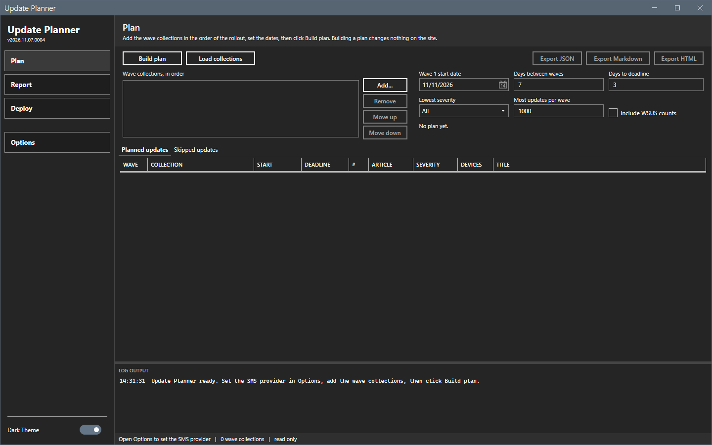
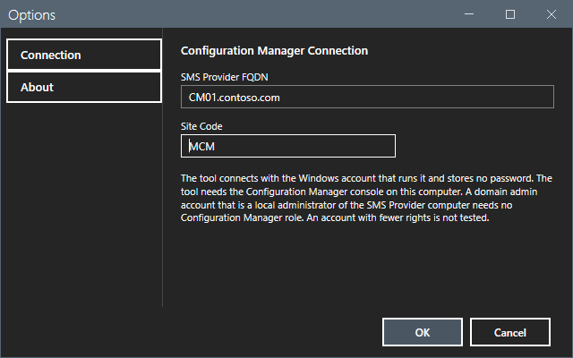
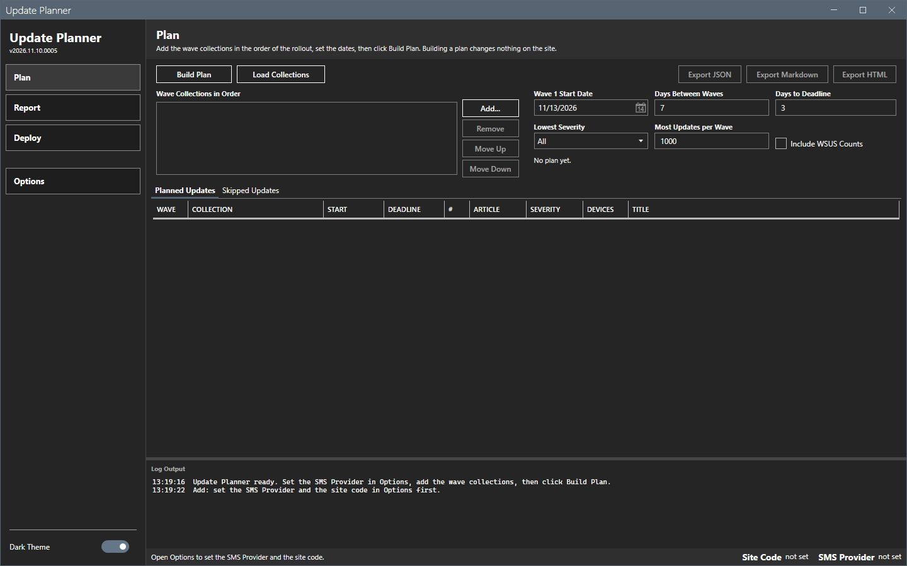
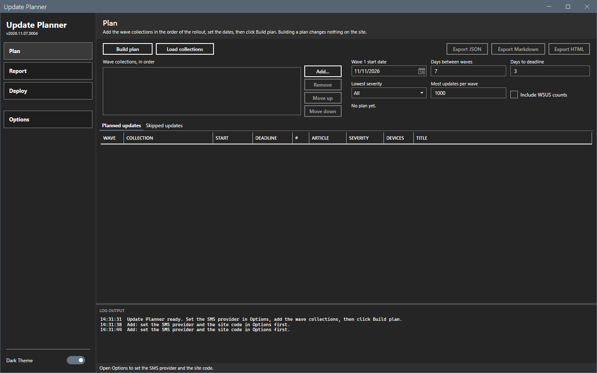
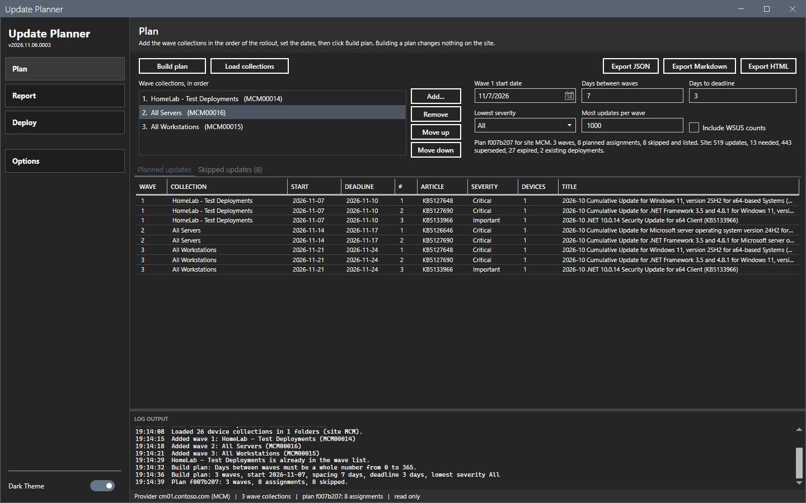
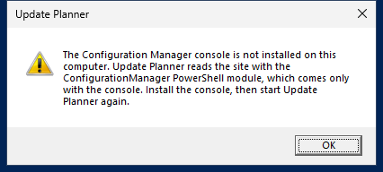
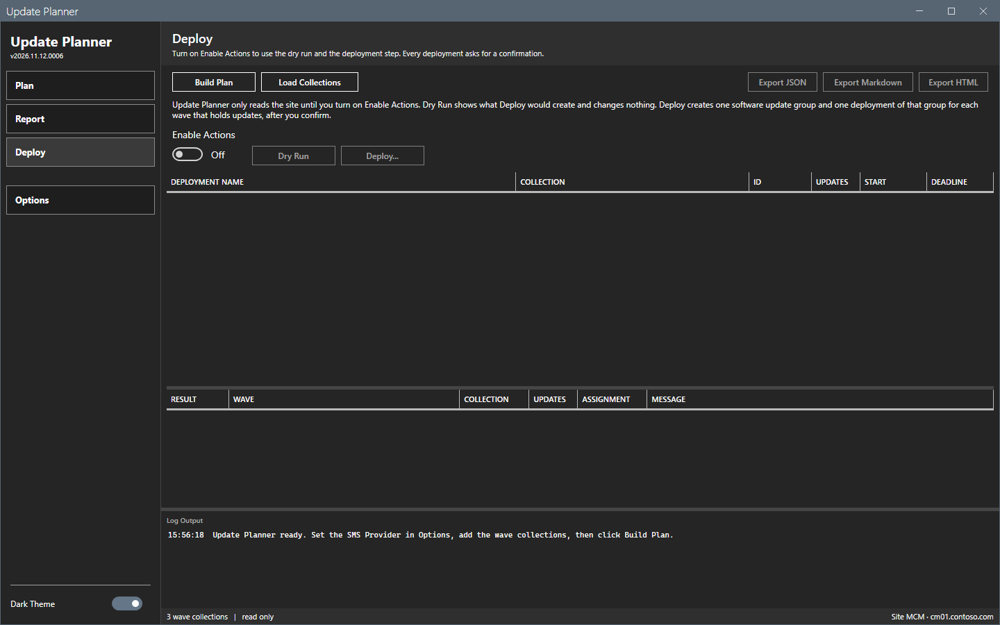

# Getting started

This page shows how to install Update Planner, set the connection to a ConfigMgr site, and build the first plan.

## What it does

Update Planner reads the software update state of a ConfigMgr site and builds a plan: which updates go to which collection, in which wave, on which dates. The plan is a review document. The tool creates deployments only when you turn on **Enable Actions** and confirm.

## When to use it

Use this page on a new installation, or when you connect the tool to a different site.

## Requirements

- Windows 10, Windows 11 or Windows Server 2016 or later.
- Windows PowerShell 5.1. PowerShell 7 also works for the command-line script.
- .NET Framework 4.7.2 or later.
- Network access from this computer to the SMS Provider computer, for the Configuration Manager console connection. PowerShell remoting (WinRM) to that computer is also necessary for WSUS counts (**Include WSUS Counts**).
- A Windows account that is a local administrator of the SMS Provider computer. A domain admin account of that kind needs no Configuration Manager role. An account with fewer rights is not tested.
- The Configuration Manager console on this computer. The tool reads the site with the ConfigurationManager PowerShell module, which comes only with the console. Without the console, the tool stops at start with a message (see below).
- A window of at least 1024 by 640 pixels. The window opens at 1320 by 820.

The tool connects with the Windows account that runs it. It stores no password and has no credential field.

## Steps

### Install

1. Download `UpdatePlanner-<version>.zip` from the Releases page of the project.
2. Extract the zip to a working folder. The folder must allow write access for your account, because the tool writes its files next to the script.
3. Open a PowerShell prompt in the folder and start the tool:

   ```powershell
   powershell -ExecutionPolicy Bypass -File start-updateplanner.ps1
   ```

   You can also right-click `start-updateplanner.ps1` and select **Run with PowerShell**.

The sidebar shows the version under the title.



Inside the AppPackager Suite, the launcher starts the tool and hands over its site code and SMS Provider. A value that you saved in the tool wins. The launcher value fills an empty one.

### Set the connection

1. Select **Options** in the sidebar.
2. In **SMS Provider FQDN**, enter the computer name or the FQDN of the SMS Provider, for example `sms01.example.com`.
3. In **Site Code**, enter the three letters or digits of the site code, for example `ABC`. The tool needs both values and no longer asks the provider for the site code.
4. Select **OK**. The right end of the footer shows the site, for example `Site ABC`, a middle dot, and `sms01.example.com`. The footer is read-only. Select the site text to open Options.



Until you set the provider and the site code, **Add...** writes "Add: set the SMS Provider and the site code in Options first." in the log, and the status bar shows "Open Options to set the SMS Provider and the site code."



A provider with no site code gives the same message.



### Build the first plan

1. On the **Plan** page, select **Load Collections**. The tool reads the device collections and the console folders. The log shows "Loaded 26 device collections in 1 folders (site ABC)." with the numbers of your site.
2. Select **Add...**. Select a collection in the picker and select **OK**. Repeat for each wave. The first collection is wave 1.
3. Select **Build Plan**.
4. Read the plan in the **Planned Updates** grid.



The plan changes nothing on the site. See [Plan page](core/plan.md) for every control.

### Start the tool on a computer without the console

The tool checks for the console at start. When the ConfigurationManager module is not found, a message box with the title **Update Planner** says so and the tool ends. Install the console, then start the tool again.



### Start the tool again

The tool keeps the connection, the settings and the wave list. It does not keep the plan or the wave 1 start date. The start date is tomorrow at each start. Build the plan again after a restart and check the start date. The window opens on the page that was open when you closed it.



## Options and settings of this page

None. See [Options dialog](core/options.md) and [Settings](reference/settings.md).

## Limits

- The tool is tested on one lab site with one primary site and one SMS Provider. A hierarchy or a remote provider is not tested.

## Troubleshooting

See [Troubleshooting](troubleshooting.md).

## Links

- [Introduction to software updates in Configuration Manager](https://learn.microsoft.com/intune/configmgr/sum/understand/software-updates-introduction): Explains how the site manages software updates.
- [Fundamentals of role-based administration](https://learn.microsoft.com/intune/configmgr/core/understand/fundamentals-of-role-based-administration): Describes the security roles, including Read-only Analyst.
