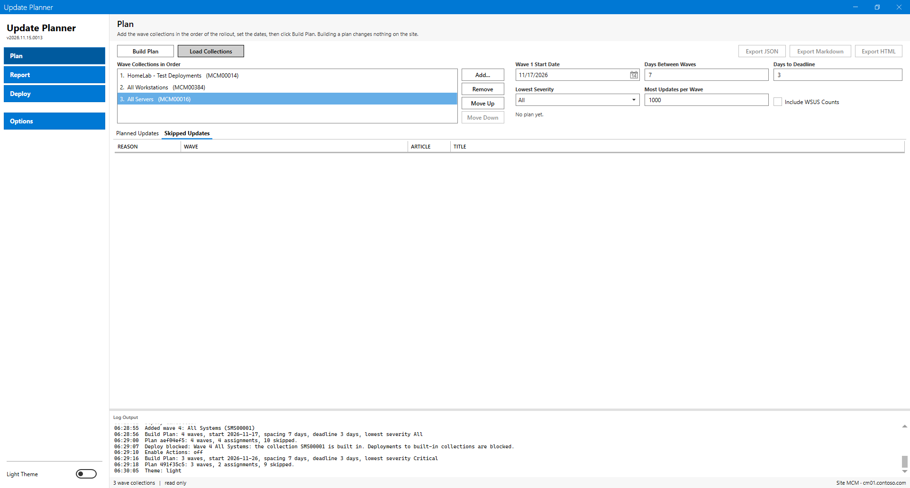
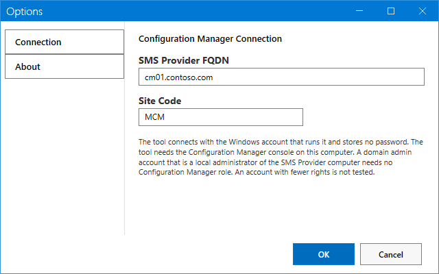
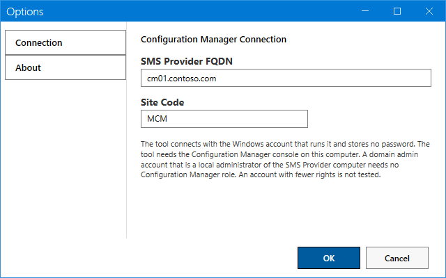
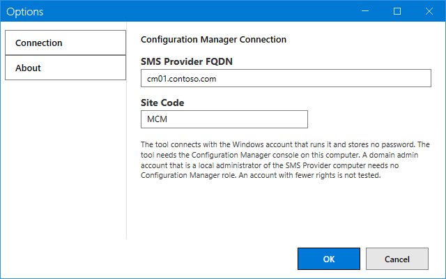
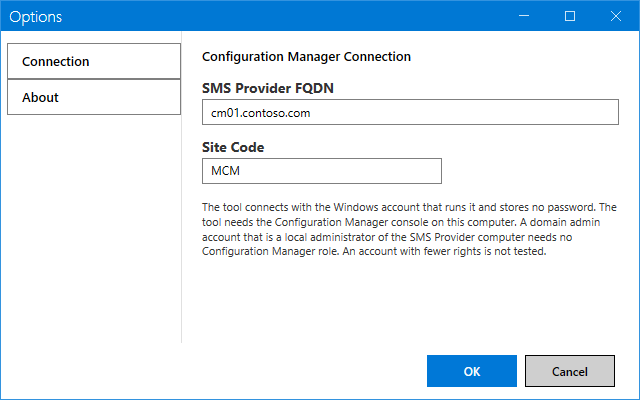

# Button states

This page shows how the buttons of Update Planner look in the normal, hover and pressed state in the light theme.

## What it does

Each button moves one visible step in the hover state and one more in the pressed state. A blue button stays blue. A gray button stays gray. A disabled button is dimmed.

## When to use it

Use this page to check that a button looks the way it should.

## Requirements

None.

## Inline button

## Sidebar button

## Dialog buttons

## Links

- [Plan page](../core/plan.md)
- [Options dialog](../core/options.md)
