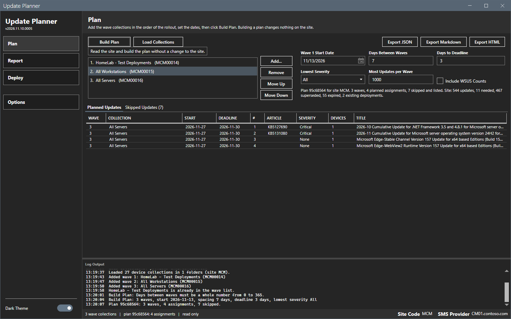

# Keyboard

This page lists the keys that Update Planner handles.

## What it does

The tool defines no shortcut of its own. It uses the standard keys of Windows controls.

## When to use it

Use this page to work without the mouse.

## Requirements

None.

## Keys

| Key | Context | Effect |
|---|---|---|
| Tab, Shift+Tab | The window | Moves the focus forward or back. |
| Space or Enter | A button | Selects the button. |
| Up, Down | The wave list, a list | Moves the selection. |
| Esc | **Add Wave Collection** picker, **Options**, a confirmation | Cancels the dialog. |
| Enter | A dialog | Selects the default button: **OK** or **Yes**. |
| Alt+F4 | The window | Closes the window and saves the settings. |

### Tab order of the Plan page

1. The sidebar: **Plan**, **Report**, **Deploy**, **Options**.
2. The toolbar: **Build Plan**, **Load Collections**, **Export JSON**, **Export Markdown**, **Export HTML**. A button that is off is skipped.
3. The wave list, then **Add...**, **Remove**, **Move Up**, **Move Down**. A button that is off is skipped.
4. **Wave 1 Start Date**, **Days Between Waves**, **Days to Deadline**, **Lowest Severity**, **Most Updates per Wave**, **Include WSUS Counts**.
5. The tab strip, the log, then the grid cells.

The focus shows as a thin white frame on a button. A tooltip shows for the button that has the focus.

## Limits

- The grids hold no keyboard action. You can move between cells with the arrow keys.
- **Yes** is the default button of the deployment confirmation. Press Esc to stop.

## Troubleshooting

| Message | Cause | Fix |
|---|---|---|
| A key does nothing. | The step is running, or the button is off. | Wait for the overlay to end. Build a plan to turn on a button. |

## Links

None.
